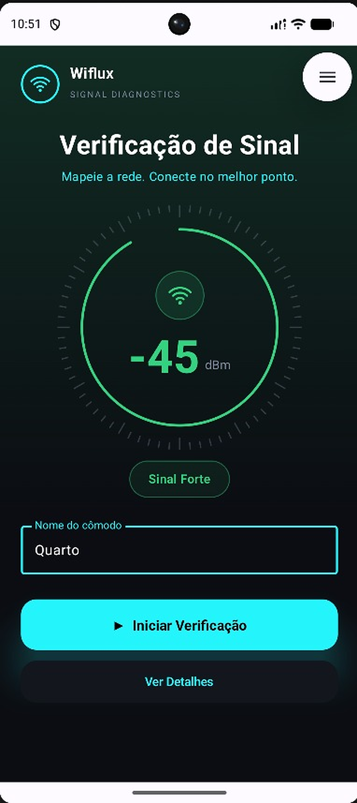
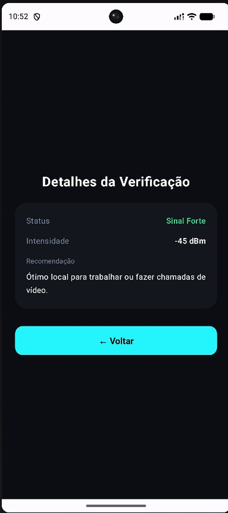

# SPEC-003 — Navegação entre Verificação de Sinal e Detalhes

> **Equipe:** Team 03  
> **Integrantes:** Célia Hiromi (@hiromilly) e Geovanna Gaspar (@gegwspar)  
> **Sprint:** SPRINT 03 — Navigation & Multiple Screens  
> **Status:** Validado  
> **Documento da Sprint:** [`SPRINT-03.md`](../../SPRINT-03.md)  

---

## 1. Contexto

**Problema:**  
Nas Sprints 01 e 02, o aplicativo **Wiflux** implementou a identidade visual e o mecanismo reativo de verificação com dial de sinal em `Canvas`. Entretanto, todos os dados eram sintetizados em uma única tela. O usuário comum precisa de orientações diagnósticas complementares (como entender se o nível de dBm aferido é propício para reuniões de trabalho, chamadas de vídeo ou se há risco de quedas) sem que a tela principal fique sobrecarregada de blocos de texto.

**Usuário / Ator:**  
Estudantes, profissionais em *home office* e usuários domésticos que realizaram a verificação de sinal Wi-Fi em um cômodo e desejam obter uma interpretação prática e detalhada do resultado.

**Contexto de Uso:**  
Após realizar a verificação de sinal na tela inicial (`HomeScreen`) e obter a classificação (ex: `"Sinal Forte"` com `-45 dBm`), o usuário toca em **"Ver Detalhes"** para abrir uma tela secundária dedicada (`DetailsScreen`) com informações completas e recomendações práticas. Após a leitura, retorna à tela inicial preservando o estado da medição.

---

## 2. Objetivo

Evoluir o aplicativo **Wiflux** de um protótipo de tela única para uma arquitetura com múltiplas telas navegáveis utilizando **Navigation Compose**, permitindo transitar de forma fluida entre a tela principal de medição (`HomeScreen`) e a tela de diagnóstico detalhado (`DetailsScreen`), garantindo a preservação do estado ao retornar e a separação dos componentes em arquivos modulares no pacote `com.team03.wifi`.

---

## 3. Cenários do Usuário (User Scenarios)

### Cenário 1: Navegação para a Tela de Detalhes
**Dado** que o usuário realizou uma verificação de sinal na tela inicial (`HomeScreen`) obtendo um resultado ativo,  
**Quando** tocar no botão **"Ver Detalhes"**,  
**Então** o aplicativo deve navegar para a tela de detalhes (`DetailsScreen`), exibindo o status verificado (ex: `"Sinal Forte"`), a intensidade numérica em dBm (`-45 dBm`) e a recomendação textual correspondente (*"Ótimo local para trabalhar ou fazer chamadas de vídeo."*).

### Cenário 2: Retorno para a Tela Inicial com Preservação de Estado
**Dado** que o usuário está visualizando a tela de detalhes (`DetailsScreen`),  
**Quando** acionar o botão **"← Voltar"** na tela ou o gesto/botão de voltar do sistema operacional Android,  
**Então** o aplicativo deve retornar à tela inicial (`HomeScreen`) mantendo exatamente o mesmo resultado de medição exibido no dial antes da navegação.

---

## 4. Requisitos Funcionais

### FR-01 — Habilitação Condicional da Ação de Detalhes
A `HomeScreen` deve exibir o botão de ação secundária **"Ver Detalhes"** somente após uma medição de sinal ter sido realizada com sucesso (`if (signalStatus != SignalStatus.NONE)`).

### FR-02 — Navegação com Passagem de Parâmetros
O acionamento do botão **"Ver Detalhes"** deve disparar o callback `onSeeDetails(signalStatus)`, navegando via `NavController` para a rota `ROUTE_DETAILS = "details/{status}"` (`navController.navigate("details/${status.name}")`) com o argumento tipado `NavType.StringType`.

### FR-03 — Renderização de Diagnóstico e Recomendações
A `DetailsScreen` deve exibir:
- O título centralizado **"Detalhes da Verificação"**;
- Um card central contendo o **Status** qualitativo (`status.label` com `status.color`), a **Intensidade** (`"${status.dbm} dBm"`) e uma **Recomendação** textual prática condizente com a qualidade do sinal medido (`when (status)`).

### FR-04 — Navegação de Retorno (Back Stack)
A `DetailsScreen` deve conter um botão **"← Voltar"** que, ao ser clicado (`onBack`), executa `navController.popBackStack()`, desempilhando a tela atual e restaurando a `HomeScreen` com o estado anterior intacto. O gesto nativo de voltar do Android também deve produzir o mesmo comportamento.

---

## 5. Restrições Técnicas

- **Framework de Navegação:** Uso obrigatório de **Navigation Compose** (`androidx.navigation:navigation-compose:2.8.4`).
- **Arquitetura Declarativa:** Não utilizar `Intent` ou múltiplas Activities legadas; toda a navegação deve ser estruturada sobre uma única `MainActivity` com `NavHost` e `rememberNavController()`.
- **Modularização de Código:** Separar as funções Composables em arquivos independentes no pacote `com.team03.wifi` (`HomeScreen.kt`, `DetailsScreen.kt`, `SignalStatus.kt` e `MainActivity.kt`), evitando centralizar todo o código em um único arquivo extenso.
- **Escopo desta Sprint:** Duas telas navegáveis (`ROUTE_HOME = "home"` e `ROUTE_DETAILS = "details/{status}"`). Não incluir abas de navegação inferior, menus laterais nem persistência em banco de dados.

---

## 6. Fora do Escopo (Out of Scope)

- Autenticação e telas de login/cadastro.
- Persistência de histórico de medições em banco de dados SQLite/Room (Sprint 05).
- Leitura de hardware Wi-Fi nativo via `WifiManager` (Sprint 06).

---

## 7. Critérios de Aceitação

- **AC-01 — Existência da SPEC-003:** O documento formal `SPEC-003.md` existe e cobre os requisitos da Sprint.
- **AC-02 — Múltiplas Telas Significativas:** O aplicativo possui pelo menos duas telas com propósitos claros (`HomeScreen` e `DetailsScreen`).
- **AC-03 — Uso de Navigation Compose:** O projeto utiliza `NavHost` e `NavController` oficiais do Jetpack Compose.
- **AC-04 — Navegação para Frente Funcional:** O toque no botão "Ver Detalhes" navega para a rota de destino levando o status correto.
- **AC-05 — Conteúdo de Destino Correto:** A tela de detalhes renderiza as informações correspondentes ao status obtido na tela inicial.
- **AC-06 — Navegação de Retorno Confiável:** O botão "← Voltar" e o botão físico/gesto do Android retornam com sucesso à tela inicial.
- **AC-07 — Preservação de Estado (Regressão):** As funcionalidades das Sprints 01 e 02 (dial em `Canvas`, medição reativa e identidade visual **Wiflux**) continuam operacionais, e o estado é preservado ao retornar via `rememberSaveable`.
- **AC-08 — Compilação e Execução Estáveis:** O aplicativo compila via Gradle e executa sem travamentos ou falhas de ciclo de vida (*no crash*).
- **AC-09 — Evidências de Navegação Registradas:** As evidências visuais das telas (`screen-a.png` e `screen-b.png`) estão salvas em `evidence/sprint-03/`.
- **AC-10 — Domínio do Grafo de Navegação:** A equipe compreende o funcionamento do `NavHost`, das rotas e do ciclo de navegação.

---

## 8. Rastreabilidade dos Requisitos

| Requisito | Implementado Em (`com.team03.wifi`) | Critério de Aceitação | Evidência |
| :--- | :--- | :--- | :--- |
| **FR-01** | `HomeScreen.kt` (`if (signalStatus != SignalStatus.NONE)`) | AC-02, AC-07 | `evidence/sprint-03/screen-a.png` |
| **FR-02** | `MainActivity.kt` (`navController.navigate("details/${status.name}")`) | AC-03, AC-04 | `evidence/sprint-03/screen-a.png` |
| **FR-03** | `DetailsScreen.kt` (`DetailsScreen`, `DetailRow`, `recommendation`) | AC-05 | `evidence/sprint-03/screen-b.png` |
| **FR-04** | `DetailsScreen.kt` e `MainActivity.kt` (`navController.popBackStack()`) | AC-06, AC-07 | `evidence/sprint-03/screen-b.png` |

---

## 9. Plano de Implementação

### Componentes Criados/Modificados (`com.team03.wifi`):
- `build.gradle.kts`: Configurado namespace `com.team03.wifi` e dependência `androidx.navigation:navigation-compose:2.8.4`.
- `SignalStatus.kt`: Enum contendo `NONE`, `STRONG (-45)`, `MEDIUM (-65)`, `WEAK (-85)` e cores da paleta compartilhada (`BackgroundDark`, `SurfaceDark`, `AccentCyan`, `TextGray`, `LineGray`).
- `HomeScreen.kt`: Composable da tela inicial (`HomeScreen`), contendo cabeçalho **Wiflux**, `RadarView` em `Canvas`, chip de status e botões `"▶ Iniciar Verificação"` e `"Ver Detalhes"`.
- `DetailsScreen.kt`: Composable da tela secundária (`DetailsScreen`) com card de diagnóstico (`DetailRow` para `Status` e `Intensidade`, além de `Recomendação`) e botão de retorno `"← Voltar"`.
- `MainActivity.kt`: Configuração da `MainActivity` com `WifiTheme`, `Scaffold`, `rememberNavController()` e `NavHost` com as rotas `ROUTE_HOME = "home"` e `ROUTE_DETAILS = "details/{status}"`.

---

## 10. Resultados da Validação

| Critério | Resultado | Observações |
| :--- | :--- | :--- |
| **AC-01** | **PASS** | Documentação técnica `SPEC-003.md` completa e rastreável. |
| **AC-02** | **PASS** | Telas `HomeScreen` e `DetailsScreen` criadas com responsabilidades bem definidas. |
| **AC-03** | **PASS** | `NavHost` e `NavController` configurados em `MainActivity.kt`. |
| **AC-04** | **PASS** | Navegação realizada via rota parametrizada `ROUTE_DETAILS = "details/{status}"`. |
| **AC-05** | **PASS** | Card de detalhes exibe Status (`Sinal Forte`), Intensidade (`-45 dBm`) e Recomendação coerente. |
| **AC-06** | **PASS** | Retorno via `popBackStack()` e botão físico testado com sucesso. |
| **AC-07** | **PASS** | Estado do dial e medição mantido ao retornar à `HomeScreen` via `rememberSaveable`. |
| **AC-08** | **PASS** | Build executado com sucesso pelo Gradle (`assembleDebug` PASS). |
| **AC-09** | **PASS** | Capturas em alta resolução salvas em `evidence/sprint-03/screen-a.png` e `screen-b.png`. |
| **AC-10** | **PASS** | Grafo de navegação simples, didático e de fácil explicação ao professor. |

### Validação Visual do Fluxo:

| 1. Tela A — `HomeScreen` (`screen-a.png`) | 2. Tela B — `DetailsScreen` (`screen-b.png`) |
| :---: | :---: |
|  |  |
| Medição realizada (`-45 dBm`, `Sinal Forte`) e botão **"Ver Detalhes"** habilitado | Diagnóstico completo (`Status`, `Intensidade`, `Recomendação`) e botão **"← Voltar"** |
