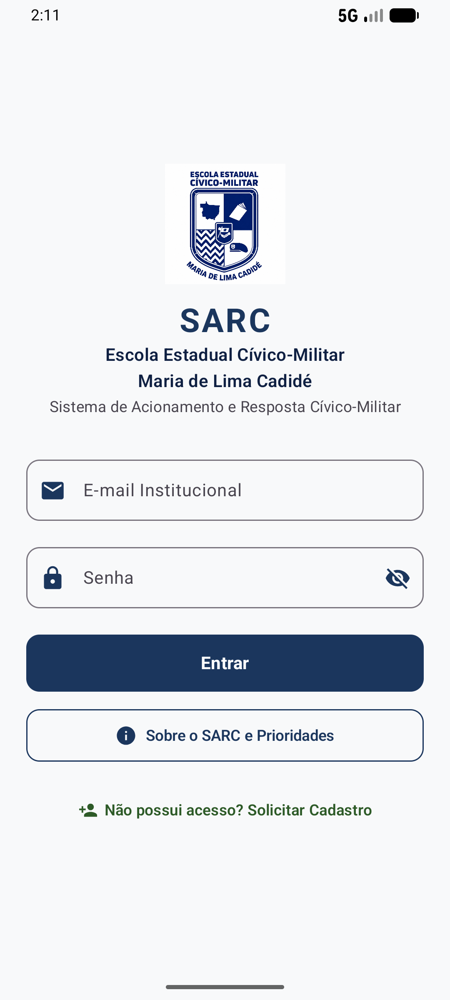
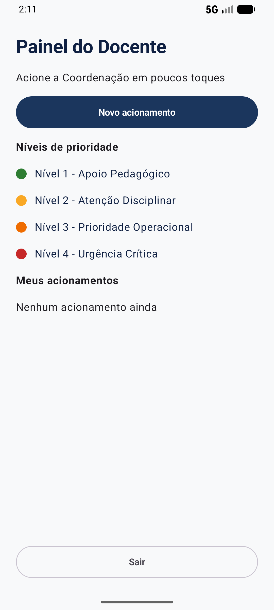

# SPRINT 03 — Navigation & Multiple Screens

## Team Identification

- **Team:** Team 05
- **Project:** SARC (Sistema de Acionamento e Resposta Cívico-Militar)
- **Institution:** Escola Estadual Cívico-Militar Maria de Lima Cadidé
- **Members:**
  - Matheus Gabriel de Morais Barros ([@MatheusGabriel-25](https://github.com/MatheusGabriel-25))
  - Paulo Vitor ([@PAULOSANTOS1309](https://github.com/PAULOSANTOS1309))

---

## 1. Navigation Need

### Selected Flow

**Login → Painel do Docente → Sair → Login.**

### Problem Solved

Até a Sprint 02, o SARC tinha uma única tela. O botão "Entrar" existia, mas não levava a lugar nenhum, e o professor não tinha onde chegar para acionar a Coordenação Militar.

### Meaningful Value for the Product

O Painel do Docente é o ponto de partida de todo acionamento. Nesta Sprint ele ganha a estrutura básica (título, botão "Novo acionamento", legenda dos níveis e a lista "Meus acionamentos"), que será preenchida nas próximas Sprints: o formulário chega na Sprint 04 e os acionamentos salvos, na Sprint 05.

---

## 2. Screens

| Tela | Arquivo | Rota | Por que existe |
| --- | --- | --- | --- |
| Login | `ui/screens/WelcomeScreen.kt` (Sprints 01 e 02) | `welcome` | Porta de entrada do app; tem os modais "Sobre o SARC" e "Solicitar Cadastro" |
| Painel do Docente | `ui/screens/HomeDocenteScreen.kt` (novo) | `home` | Onde o professor vai acionar a Coordenação e ver os seus acionamentos |

Cada tela fica em um arquivo próprio. O `MainActivity.kt` só monta o mapa de navegação.

---

## 3. Navigation Graph

```text
            "Entrar"  →  navigate("home")
 [welcome] ─────────────────────────────▶ [home]
     ▲                                       │
     └──────── "Sair"  →  popBackStack() ────┘
```

| Item | Onde fica | O que faz |
| --- | --- | --- |
| `NavController` | `MainActivity.kt` L48 (`rememberNavController()`) | Lembra em qual tela o usuário está e guarda a pilha de telas |
| `NavHost` | `MainActivity.kt` L51 (`startDestination = "welcome"`) | O "mapa" das telas: diz qual tela desenhar para cada rota |
| Rota `welcome` | `MainActivity.kt` L54 | Desenha a `WelcomeScreen` |
| Rota `home` | `MainActivity.kt` L62 | Desenha a `HomeDocenteScreen` |
| Ida | `MainActivity.kt` L57 | "Entrar" chama `navController.navigate("home")`: o painel entra por cima do Login na pilha |
| Volta | `MainActivity.kt` L65 + `HomeDocenteScreen.kt` L99–105 | "Sair" chama `navController.popBackStack()`: o painel sai da pilha e o Login aparece |

### How Back Navigation Was Validated

No emulador, a partir do Painel do Docente, tocamos em "Sair" e conferimos que a tela de Login voltou (`home-sair.png`). Repetimos o ciclo Entrar → Sair 10 vezes seguidas, sem travar e sem nenhum `FATAL EXCEPTION` no logcat.

---

## 4. Scope & Requirements

### Functional Requirements

| FR | Descrição |
| --- | --- |
| FR-01 | `NavHost` com 2 rotas: `welcome` e `home` |
| FR-02 | "Entrar" abre o Painel do Docente |
| FR-03 | O painel mostra título e subtítulo |
| FR-04 | O painel mostra a legenda dos 4 níveis com as cores do tema |
| FR-05 | "Meus acionamentos" vazia, com "Nenhum acionamento ainda" |
| FR-06 | "Novo acionamento" abre o aviso "O formulário de acionamento chega na Sprint 04" |
| FR-07 | "Sair" volta ao Login |

Detalhes e critérios em [`docs/specs/SPEC-003.md`](docs/specs/SPEC-003.md).

### Out of Scope

Login real, formulário de acionamento (Sprint 04), dados salvos (Sprint 05), internet e notificações (Sprint 06).

---

## 5. Acceptance Criteria (curso)

- [x] AC-01 — SPEC-003 exists.
- [x] AC-02 — At least two meaningful screens exist (Login e Painel do Docente).
- [x] AC-03 — Navigation Compose is used (`NavHost` + `NavController`).
- [x] AC-04 — User action navigates between destinations ("Entrar").
- [x] AC-05 — Destination content is visible (`screen-b.png`).
- [x] AC-06 — Back navigation behaves correctly ("Sair" volta ao Login).
- [x] AC-07 — Previous Sprint functionality remains operational (modais da Sprint 02).
- [x] AC-08 — App builds/runs without crashing.
- [x] AC-09 — Navigation evidence exists.
- [x] AC-10 — Team can explain the navigation graph (seção 3).

Os critérios da própria SPEC-003 (AC-01 a AC-10) estão na seção 11 da SPEC, todos em PASS.

---

## 6. Regression Validation

| Funcionalidade anterior | Resultado |
| --- | --- |
| Modal "Sobre o SARC": cartões expansíveis (Sprint 02) | PASS — o cartão do Nível 4 abre com a descrição (`sprint-02-regression.png`) |
| Modal "Solicitar Cadastro": guia em 3 etapas (Sprint 02) | PASS — "Etapa 1 de 3" → "Próximo" → "Etapa 2 de 3" com "Voltar" |
| Tela de Login (Sprint 01) | PASS — mesma aparência (`screen-a.png`) |

---

## 7. Evidence

### Screen A — Login (`welcome`)



### Screen B — Painel do Docente (`home`)



### Additional Evidence

| Arquivo | O que mostra |
| --- | --- |
| `home-aviso.png` | aviso de "Novo acionamento" |
| `home-sair.png` | Login de volta depois de "Sair" |
| `sprint-02-regression.png` | modal da Sprint 02 funcionando |

---

## 8. AI Usage

| Item | Team response |
| --- | --- |
| LLM/tool used | Claude (Claude Code) — Claude Opus 5.5 e Claude Sonnet 5.5 |
| Task supported by the LLM | Ler o `SPRINT-03.md`, montar a SPEC-003, sugerir o `NavHost` e a nova tela, instalar o ambiente e capturar as evidências |
| Main suggestion received | `NavHost` com as rotas `welcome` e `home`, e uma tela nova em arquivo próprio. A primeira versão usava `popUpTo` para o voltar do Android fechar o app |
| What the team changed manually | Escolhemos o escopo (só o painel, código no nível MVP), os textos e a lista vazia. Testando no emulador, rejeitamos o `popUpTo` e ficamos com a versão mais simples: só "Sair" volta ao Login, com `popBackStack()` |
| How the result was validated | `./gradlew assembleDebug`, teste manual de cada AC no emulador Pixel 8 (API 37), 10 ciclos Entrar → Sair e logcat sem crash |

---

## 9. Deliverables

- `projects/team-05/app/`
- `projects/team-05/SPRINT-03.md`
- `projects/team-05/docs/specs/SPEC-003.md`
- `projects/team-05/evidence/sprint-03/screen-a.png`
- `projects/team-05/evidence/sprint-03/screen-b.png`
