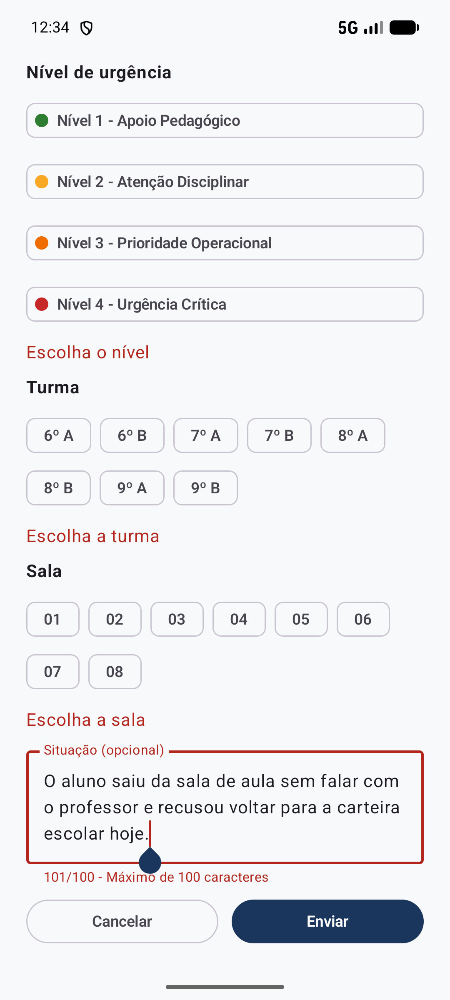
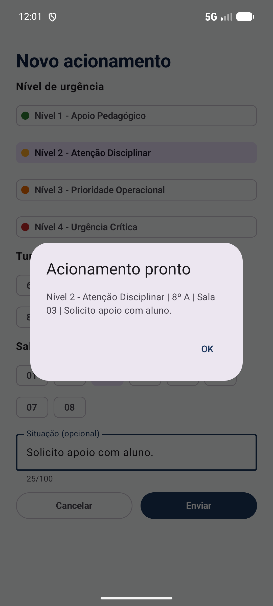

# SPRINT 04: User Input, Forms & Validation

## Team Identification

- **Team:** Team 05
- **Project:** SARC (Sistema de Acionamento e Resposta Cívico-Militar)
- **Institution:** Escola Estadual Cívico-Militar Maria de Lima Cadidé
- **Members:**
  - Matheus Gabriel de Morais Barros ([@MatheusGabriel-25](https://github.com/MatheusGabriel-25))
  - Paulo Vitor ([@PAULOSANTOS1309](https://github.com/PAULOSANTOS1309))

---

## 1. User Input Flow

### Selected Flow

**Painel do Docente → "Novo acionamento" → Formulário (preenchimento e validação) → "Enviar" → Aviso de confirmação → "OK" → Painel do Docente.**

### Problem Solved

Na Sprint 03, o botão "Novo acionamento" do Painel do Docente exibia apenas um aviso informando que o formulário chegaria na Sprint 04. O professor ainda não conseguia informar o nível de urgência, a turma, a sala e a situação da ocorrência.

### Meaningful Value for the Product

Em sala de aula, o professor precisa acionar a Coordenação Militar com rapidez. Por isso, os 3 campos obrigatórios (**Nível de urgência**, **Turma** e **Sala**) são preenchidos apenas com toques em botões de escolha (`FilterChip`), sem exigir digitação, e o campo de texto (**Situação**) é opcional. Quando os dados passam pela validação, o aplicativo monta a mensagem padronizada do protocolo cívico-militar da escola. Salvar os acionamentos na lista "Meus acionamentos" fica para a Sprint 05 (Room).

---

## 2. Form Fields & State

Cada campo do formulário é controlado por um estado em `rememberSaveable` dentro de `ui/screens/NovoAcionamentoScreen.kt`, preservando o valor mesmo se a tela do celular girar:

| Campo | Obrigatório / Opcional | Componente Compose | Estado (`NovoAcionamentoScreen.kt`) | Valores Permitidos / Formato |
| --- | --- | --- | --- | --- |
| **Nível de urgência** | Obrigatório | 4 botões `FilterChip` com bolinha na cor da faixa (L108-116) | `var nivel by rememberSaveable { mutableStateOf("") }` (L81) | Um dos 4 níveis oficiais do SARC (L51-56): `Nível 1 - Apoio Pedagógico`, `Nível 2 - Atenção Disciplinar`, `Nível 3 - Prioridade Operacional` ou `Nível 4 - Urgência Crítica` |
| **Turma** | Obrigatório | Linha de botões `FilterChip` via função `Escolhas` (L121 e L165-170) | `var turma by rememberSaveable { mutableStateOf("") }` (L82) | Lista de exemplo até confirmação final da escola (L57): `6º A`, `6º B`, `7º A`, `7º B`, `8º A`, `8º B`, `9º A`, `9º B` |
| **Sala** | Obrigatório | Linha de botões `FilterChip` via função `Escolhas` (L125 e L165-170) | `var sala by rememberSaveable { mutableStateOf("") }` (L83) | Lista de exemplo (L58): `01`, `02`, `03`, `04`, `05`, `06`, `07`, `08` |
| **Situação** | Opcional | `OutlinedTextField` com contador `${situacao.length}/100` (L129-136) | `var situacao by rememberSaveable { mutableStateOf("") }` (L84) | Texto livre de **0 a 100 caracteres**. Se ficar vazio ou só com espaços, o app usa `"Solicito apoio."` ao montar a mensagem (L152) |

### Estados Auxiliares do Formulário

| Estado | Onde fica | Para que serve |
| --- | --- | --- |
| `tentouEnviar` | `NovoAcionamentoScreen.kt` L85 | Começa em `false` e passa para `true` no primeiro toque em `"Enviar"` (L142), evitando que a tela já abra com avisos vermelhos antes de o professor tentar enviar |
| `aceito` | `NovoAcionamentoScreen.kt` L86 | Passa para `true` quando o professor toca em `"Enviar"` sem nenhum erro (`!erros.temErro`, L143), abrindo o `AlertDialog` com a mensagem do protocolo (L151-159) |

---

## 3. Validation Rules & Implementation

Todas as 4 regras de validação estão concentradas em **uma única função** (`validar`, nas linhas **66 a 71** de `NovoAcionamentoScreen.kt`), que retorna um objeto da classe `Erros` (linhas **61 a 63**):

| Regra | Condição de Erro | Mensagem Exibida | Onde a regra é avaliada | Onde o erro aparece na interface |
| --- | --- | --- | --- | --- |
| **Regra 1: Nível obrigatório** | `nivel.isEmpty()` | `"Escolha o nível"` | `NovoAcionamentoScreen.kt` L67 | `Aviso(if (tentouEnviar) erros.nivel else null)` (L117 e L175-177) |
| **Regra 2: Turma obrigatória** | `turma.isEmpty()` | `"Escolha a turma"` | `NovoAcionamentoScreen.kt` L68 | `Aviso(if (tentouEnviar) erros.turma else null)` (L122 e L175-177) |
| **Regra 3: Sala obrigatória** | `sala.isEmpty()` | `"Escolha a sala"` | `NovoAcionamentoScreen.kt` L69 | `Aviso(if (tentouEnviar) erros.sala else null)` (L126 e L175-177) |
| **Regra 4: Limite de 100 caracteres na Situação** | `situacao.length > 100` | `"Máximo de 100 caracteres"` | `NovoAcionamentoScreen.kt` L70 | `OutlinedTextField`: `isError = erros.situacao != null` (L133) e `supportingText` exibindo `"${situacao.length}/100 - Máximo de 100 caracteres"` (L134) |

### Como o Bloqueio e a Limpeza de Erros Funcionam

1. **Reavaliação automática:** Na linha 88, `val erros = validar(nivel, turma, sala, situacao)` roda a cada recomposição. Assim que o professor escolhe o campo que faltava ou apaga caracteres acima de 100, o aviso daquele campo desaparece imediatamente.
2. **Permissão para ultrapassar 100 caracteres:** O `OutlinedTextField` não trava a digitação no caractere 100 de propósito, permitindo digitar 101 ou mais caracteres para que a borda vermelha e a mensagem `"101/100 - Máximo de 100 caracteres"` fiquem visíveis para o usuário.
3. **Bloqueio do envio:** Na linha 143, o botão `"Enviar"` verifica `if (!erros.temErro) aceito = true`. Enquanto `temErro` (L62) for `true`, o modal de confirmação não abre.

Detalhes completos e rastreabilidade em [`docs/specs/SPEC-004.md`](docs/specs/SPEC-004.md).

---

## 4. Scenario Testing & Regression

### Cenário Inválido (`invalid-input.png`)

1. No emulador `Pixel_8_API_37`, abrimos o aplicativo, tocamos em `"Entrar"` e em `"Novo acionamento"`.
2. Mantivemos **Nível**, **Turma** e **Sala** sem seleção, digitamos um texto de **101 caracteres** no campo **Situação** (`"O aluno saiu da sala de aula sem falar com o professor e recusou voltar para a carteira escolar hoje."`) e tocamos em `"Enviar"`.
3. **Resultado validado:** O envio foi bloqueado e a tela exibiu os 4 avisos em vermelho (`Escolha o nível`, `Escolha a turma`, `Escolha a sala` e `101/100 - Máximo de 100 caracteres`). Também testamos com exatamente 100 caracteres e confirmamos que o erro da situação desaparece.

### Cenário Válido (`valid-input.png`)

1. Escolhemos `Nível 2 - Atenção Disciplinar`, turma `8º A`, sala `03` e digitamos `"Solicito apoio com aluno."` (`25/100`).
2. Tocamos em `"Enviar"`.
3. **Resultado validado:** O aplicativo abriu o diálogo `"Acionamento pronto"` com a mensagem `"Nível 2 - Atenção Disciplinar | 8º A | Sala 03 | Solicito apoio com aluno."`. Ao tocar em `"OK"`, voltou ao Painel do Docente mantendo `"Nenhum acionamento ainda"`.

### Teclado Virtual, Voltar e Regressão das Sprints Anteriores

| Item testado | Resultado |
| --- | --- |
| Teclado virtual do celular no campo "Situação" (`Modifier.imePadding()`, L94) | PASS: o formulário sobe acima do teclado sem esconder o texto digitado |
| Botão `"Cancelar"` e botão voltar do Android no formulário | PASS: voltam ao Painel do Docente sem enviar |
| Fluxo `Login → Entrar → Painel → Sair → Login` (Sprint 03) | PASS: navegação funcionando normalmente |
| Modais `"Sobre o SARC"` e `"Solicitação de Cadastro"` (Sprint 02) | PASS: cartões expansíveis e guia de 3 etapas intactos |
| Estabilidade (10 envios seguidos + logcat) | PASS: `./gradlew assembleDebug` sem erros e 0 `FATAL EXCEPTION` |

---

## 5. Acceptance Criteria (Curso)

- [x] AC-01: SPEC-004 exists (`docs/specs/SPEC-004.md`).
- [x] AC-02: Meaningful user-input flow exists (formulário "Novo acionamento").
- [x] AC-03: Input values use UI state (`rememberSaveable` para `nivel`, `turma`, `sala` e `situacao`).
- [x] AC-04: At least one validation rule is implemented (3 campos obrigatórios + limite máximo de 100 caracteres).
- [x] AC-05: Invalid input produces visible feedback (avisos em vermelho e contador `101/100 - Máximo de 100 caracteres`).
- [x] AC-06: Valid input is accepted according to the SPEC (modal com a mensagem do protocolo e retorno ao Painel).
- [x] AC-07: Valid and invalid evidence exists (`valid-input.png` e `invalid-input.png`).
- [x] AC-08: Previous functionality still works (Login, modais da Sprint 02 e navegação da Sprint 03).
- [x] AC-09: App builds/runs successfully (`./gradlew assembleDebug`: `BUILD SUCCESSFUL`).
- [x] AC-10: Team can explain validation logic (seções 2 e 3 deste relatório).

---

## 6. Evidence

### Invalid Input (`invalid-input.png`)

### Valid Input (`valid-input.png`)

---

## 7. AI Usage

| Item | Team response |
| --- | --- |
| LLM/tool used | Claude Code (Anthropic) e Google Antigravity (Gemini) |
| Task supported by the LLM | Discutir o planejamento em módulos antes da execução, estruturar a `SPEC-004.md` a partir das decisões da equipe, implementar o formulário em Jetpack Compose (`NovoAcionamentoScreen.kt` e rota no `MainActivity.kt`) sob orientação passo a passo do Matheus, corrigir o ajuste do teclado virtual (`imePadding`) e apoiar na captura das evidências e revisão do relatório |
| Main suggestion received | Formulário em tela própria (`novo-acionamento`) usando `rememberSaveable` para os 4 estados, `FilterChip` reutilizável para as escolhas por toque, uma única função `validar(...)` concentrando todas as regras e `Modifier.imePadding()` na coluna rolável para o teclado virtual não cobrir o campo de texto |
| What the team changed manually | A equipe não pediu para a IA gerar tudo sozinha: o Matheus e o Paulo montaram primeiro um plano dividido em módulos e foram orientando, revisando e aprovando cada etapa. O Paulo definiu a substituição das 9 palavras-chave pelos 4 níveis de urgência com nome completo para simplificar o uso pelo docente em sala. O Matheus definiu a regra da situação opcional com limite de 100 caracteres e listas de exemplo para turma e sala. Ao testar manualmente no emulador, o Matheus identificou que o teclado do celular cobria o campo "Situação" e que o primeiro print de entrada inválida cortava os botões inferiores; a equipe então aplicou o `Modifier.imePadding()`, ajustou a configuração de teclado do emulador e refez a evidência `invalid-input.png` |
| How the result was validated | Compilação com `./gradlew assembleDebug` e `installDebug` (`BUILD SUCCESSFUL`), teste manual no emulador Pixel 8 (API 37) cobrindo os cenários inválido (vazio e 101 caracteres), limite (100 caracteres) e válido, teste de abertura do teclado virtual no campo de texto, teste do botão voltar do Android, 10 envios seguidos sem `FATAL EXCEPTION` no logcat e teste de não-regressão das Sprints 01, 02 e 03 |

---

## 8. Deliverables

- `projects/team-05/app/`
- `projects/team-05/SPRINT-04.md`
- `projects/team-05/docs/specs/SPEC-004.md`
- `projects/team-05/evidence/sprint-04/valid-input.png`
- `projects/team-05/evidence/sprint-04/invalid-input.png`
