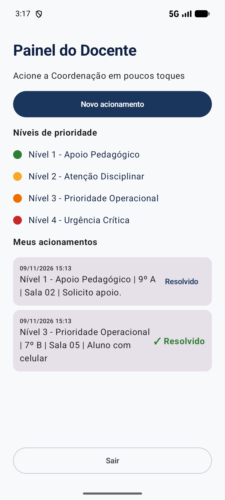
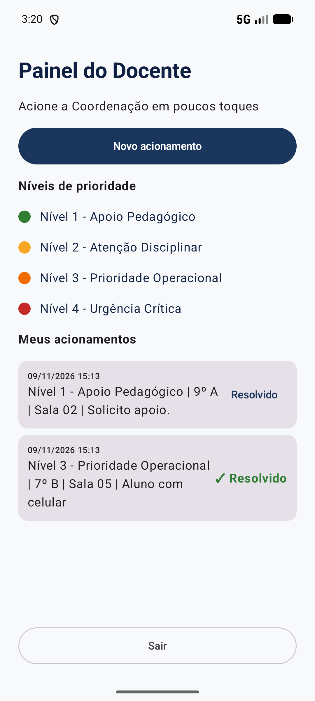

# SPRINT 05: Local Persistence & Data

## Team Identification

- **Team:** Team 05
- **Project:** SARC (Sistema de Acionamento e Resposta Cívico-Militar)
- **Institution:** Escola Estadual Cívico-Militar Maria de Lima Cadidé
- **Members:**
  - Matheus Gabriel de Morais Barros ([@MatheusGabriel-25](https://github.com/MatheusGabriel-25))
  - Paulo Vitor ([@PAULOSANTOS1309](https://github.com/PAULOSANTOS1309))

---

## 1. Persistence Choice

### What Must Persist

O **histórico de acionamentos** do professor: a mensagem pronta do protocolo, a data e a hora do envio e se o acionamento já foi marcado como resolvido.

### Selected Mechanism: Room

Escolhemos o **Room** (e não o DataStore) porque o histórico é uma **lista de registros estruturados que cresce** a cada envio. O DataStore serve para valores soltos e pequenos, como "tema escuro ligado".

### Problem Solved

Na Sprint 04, ao tocar em "Enviar", o aplicativo mostrava a mensagem pronta e ela sumia: se o app fosse fechado, não sobrava registro, e o Painel do Docente continuava dizendo "Nenhum acionamento ainda".

### Meaningful Value for the Product

O professor consegue **conferir se o acionamento foi enviado**, mesmo depois de fechar o app ou desligar o aparelho, e marcar como **resolvido** o que já foi atendido.

---

## 2. Data Model

Tabela `acionamentos` (`data/AcionamentoDatabase.kt`, classe `AcionamentoEntity`, L15-21):

| Coluna | Tipo | Para que serve |
| --- | --- | --- |
| `id` | `Int` (chave primária, automática) | Número da linha; o Room preenche sozinho |
| `mensagem` | `String` | A mensagem do protocolo: `[NÍVEL] \| [TURMA] \| Sala [SALA] \| [SITUAÇÃO]` |
| `dataHora` | `Long` | Momento do envio, em milissegundos (`System.currentTimeMillis()`) |
| `resolvido` | `Boolean` | Começa `false`; vira `true` ao tocar em "Resolvido" |

Não inventamos campos além dos que a `SPEC-005` exige.

---

## 3. Data Flow & Implementation

O código do banco fica **separado das telas**, em `data/AcionamentoDatabase.kt`. As telas só recebem a lista e avisam o que aconteceu; quem liga tudo é o `MainActivity.kt`.

| Operação | Onde está | Como funciona |
| --- | --- | --- |
| **Salvar** | `AcionamentoDao.salvar` (L27-28), chamado em `MainActivity.kt` L92-95 | O "Enviar" válido (`NovoAcionamentoScreen.kt` L145) chama `onEnviar(mensagem)`; o `MainActivity` grava a linha com a hora de agora. Formulário com erro não grava |
| **Ler e mostrar** | `AcionamentoDao.listarTodos` (L31-32, devolve `Flow`), `MainActivity.kt` L75 (`collectAsState`), `HomeDocenteScreen.kt` L99-101 (`LazyColumn`) e L145-153 (`AcionamentoItem`) | A consulta ordena por `id DESC` (mais novo primeiro). O Painel "assina" a tabela e se atualiza sozinho a cada mudança |
| **Alterar** | `AcionamentoDao.marcarResolvido` (L35-36), `MainActivity.kt` L83, botão em `HomeDocenteScreen.kt` L152-153 | "Resolvido" faz `UPDATE ... SET resolvido = 1` só naquela linha; o cartão passa a mostrar "✓ Resolvido" |
| **Guardar no aparelho** | `Room.databaseBuilder(..., "sarc.db")` (L49) | O Room grava um arquivo `sarc.db` dentro do aparelho; por ser arquivo, sobrevive a fechar o app e a desligar o aparelho |

### Explicação em uma frase (fluxo de dados)

Formulário válido → `salvar` grava a linha no `sarc.db` → o `listarTodos` avisa o Painel → o Painel mostra o cartão; ao reabrir o app (ou reiniciar o aparelho), o Painel lê o **mesmo arquivo** e a lista volta igual.

### Por que as chamadas ao banco ficam nos "bastidores"

`salvar` e `marcarResolvido` são funções `suspend` chamadas dentro de uma coroutine (`scope.launch`), e não usamos `allowMainThreadQueries`. Assim a tela nunca trava esperando o banco.

Detalhes completos e rastreabilidade em [`docs/specs/SPEC-005.md`](docs/specs/SPEC-005.md).

---

## 4. Persistence Validation & Regression

Todos os testes foram feitos no emulador `Pixel_8_API_37` (Android API 37), começando com os dados do app limpos.

### Criar (`data-created.png`)

1. Painel vazio: aparece "Nenhum acionamento ainda".
2. Formulário vazio + "Enviar": aparecem os 3 avisos vermelhos e, ao voltar, o Painel continua vazio (**nada foi gravado**).
3. Enviamos `Nível 3 - Prioridade Operacional | 7º B | Sala 05 | Aluno com celular` (texto digitado) e `Nível 1 - Apoio Pedagógico | 9º A | Sala 02 | Solicito apoio.`
4. **Resultado:** os 2 cartões aparecem com `09/11/2026 15:13`, o mais novo no topo. Tocamos em "Resolvido" só no mais antigo e ele passou a mostrar "✓ Resolvido", sem mexer no outro. Print às 3:14 do relógio do aparelho.

### Restaurar (`data-restored.png` e `data-restored-reboot.png`)

1. **Fechar o app por completo** (`am force-stop`; o processo deixou de existir) e reabrir às 3:17: a lista voltou **igual**, com os cartões de 15:13 e a mesma marcação "✓ Resolvido" (`data-restored.png`).
2. **Reiniciar o aparelho** (emulador ligado há cerca de 22 s) às 3:20, reabrir o app e entrar: a lista continuou **igual** (`data-restored-reboot.png`).
3. Os três prints mostram horários diferentes no relógio (3:14, 3:17 e 3:20), enquanto os cartões continuam marcando 15:13: o dado foi criado antes e continuou lá.

### Regressão das Sprints Anteriores

| Item testado | Resultado |
| --- | --- |
| Validação do formulário (Sprint 04): avisos e bloqueio do envio | PASS |
| Fluxo `Login → Entrar → Painel → Sair → Login` (Sprint 03) | PASS |
| Modais `"Sobre o SARC"` e `"Solicitação de Cadastro"` (Sprint 02) | PASS |
| Botão voltar do Android (fecha os modais e sai do Painel) | PASS |
| Estabilidade (10 envios seguidos + logcat) | PASS: `./gradlew assembleDebug` com `BUILD SUCCESSFUL` e 0 `FATAL EXCEPTION` |

---

## 5. Acceptance Criteria (Curso)

- [x] AC-01: SPEC-005 exists (`docs/specs/SPEC-005.md`).
- [x] AC-02: Appropriate persistence mechanism selected (Room, seção 1).
- [x] AC-03: Required persistent data is modeled (`AcionamentoEntity`, seção 2).
- [x] AC-04: Data can be saved/changed (`salvar` e `marcarResolvido`).
- [x] AC-05: Data can be read and displayed/used (`listarTodos` e lista do Painel).
- [x] AC-06: Expected data survives app restart (`data-restored.png` e `data-restored-reboot.png`).
- [x] AC-07: Previous functionality remains operational (tabela de regressão da seção 4).
- [x] AC-08: App builds successfully (`./gradlew assembleDebug`: `BUILD SUCCESSFUL`).
- [x] AC-09: Persistence evidence exists (os 3 prints da seção 6).
- [ ] AC-10: Team can explain the data flow (fluxo na seção 3; o Matheus e o Paulo marcam depois de estudar).

---

## 6. Evidence

### Data Created (`data-created.png`)

### Data Restored after closing the app (`data-restored.png`)

### Data Restored after restarting the device (`data-restored-reboot.png`)

---

## 7. AI Usage

| Item | Team response |
| --- | --- |
| LLM/tool used | Claude Code (Anthropic) |
| Task supported by the LLM | Comparar Room e DataStore para o nosso caso, rascunhar a `SPEC-005.md`, escrever o código do Room (`AcionamentoDatabase.kt`) e as mudanças em `MainActivity.kt`, `HomeDocenteScreen.kt` e `NovoAcionamentoScreen.kt`, configurar Room e KSP no Gradle, executar os testes no emulador e capturar as evidências |
| Main suggestion received | Pôr todo o banco em um arquivo só (`Entity`, `Dao` e `Database`), com as telas sem conhecer o banco (recebem a lista e avisam o que aconteceu); usar `Flow` para o Painel se atualizar sozinho; rodar as gravações em coroutines para a tela não travar |
| What the team changed manually | O trabalho seguiu um plano em módulos, com um rascunho aprovado antes de cada etapa. O Matheus decidiu: mostrar **data e hora** em cada acionamento; incluir o botão **"Resolvido"**; deixar para depois da Sprint a separação entre a lista principal (só os não atendidos) e um botão "Acionamentos feitos"; e pediu que a prova de persistência fosse feita **fechando o app e reiniciando o aparelho**, com prints de horários diferentes, e os primeiros prints saíram idênticos e por isso foram refeitos |
| How the result was validated | Compilação com `./gradlew assembleDebug` (`BUILD SUCCESSFUL`), testes manuais no emulador Pixel 8 (API 37) com os dados limpos (lista vazia, envio com erro, 2 envios, "Resolvido", fechar o app, reiniciar o aparelho), 10 envios seguidos sem `FATAL EXCEPTION` no logcat e teste de não-regressão das Sprints 01 a 04 |

---

## 8. Deliverables

- `projects/team-05/app/`
- `projects/team-05/SPRINT-05.md`
- `projects/team-05/docs/specs/SPEC-005.md`
- `projects/team-05/evidence/sprint-05/data-created.png`
- `projects/team-05/evidence/sprint-05/data-restored.png`
- `projects/team-05/evidence/sprint-05/data-restored-reboot.png`
